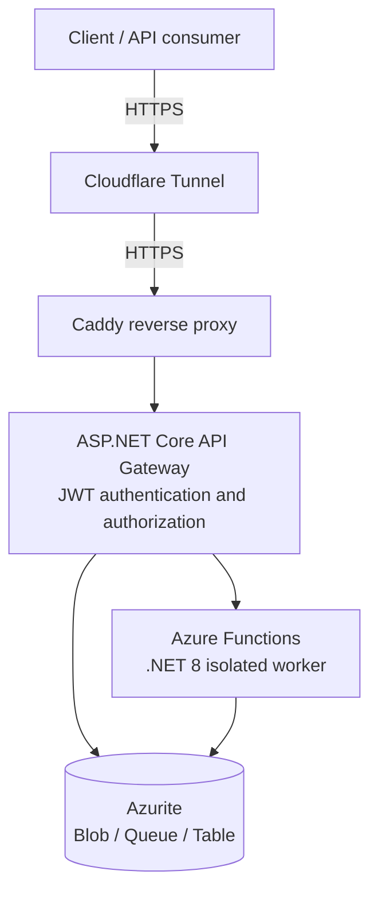

# CoffeeNChill 

**Cloud Development POE — Part 3**  
ASP.NET Core API Gateway · Azure Functions (.NET 8 isolated) · Azure Storage-compatible services · Docker Compose

CoffeeNChill is a containerised coffee-shop backend that exposes a single HTTP API for customer authentication, menu management, order processing and staff-document operations. An ASP.NET Core API Gateway handles incoming requests and authentication; Azure Functions provide backend operations, with Azurite supplying local Azure Storage-compatible services for the deployed demonstration environment.

> **Deployment status:** The API has been deployed and tested over HTTPS, including successful registration, login, menu retrieval and order submission. The public endpoint remained available after a VPS reboot. This is a **POE/demo deployment**, not a production-ready customer-data platform.

## Live API

**Base URL:** `https://api.cowleylab.co.za`

Verified public endpoint:

```bash
curl -i https://api.cowleylab.co.za/api/menu
```

At the time of testing, this returned `HTTP 200` with an empty JSON array (`[]`), indicating that the API was reachable but no menu items had been populated.

## Architecture



The deployment uses two Docker networks:

- **Frontend network:** Caddy ↔ API Gateway.
- **Backend network:** API Gateway ↔ Azure Functions ↔ Azurite.

Only Caddy publishes HTTP/HTTPS ports on the host. The API Gateway, Functions and storage services communicate through Docker's internal networks. The Cloudflare Tunnel forwards public traffic to the configured origin.

## Technology stack

| Layer | Technology |
|---|---|
| API Gateway | ASP.NET Core, .NET 8 |
| Serverless backend | Azure Functions, .NET 8 isolated worker |
| Authentication | JWT bearer tokens with role-based authorization |
| Storage for demonstration | Azurite (Azure Blob, Queue and Table Storage emulator) |
| Containers | Docker and Docker Compose |
| Reverse proxy / HTTPS origin | Caddy |
| Public routing | Cloudflare Tunnel |
| Deployment host | Ubuntu Linux VPS Hosted on a Proxmox Server |

## Key functionality

- Customer registration and login.
- JWT generation and role-based API authorization.
- Menu retrieval and menu-management operations.
- Order submission with queue-based processing.
- Order status/details retrieval for authorized staff.
- Staff-document operations backed by blob storage.

> **Authorization:** The intended roles include `Customer`, `Staff` and `Admin`. Review and test every privileged endpoint before using the service with real customer data. In particular, the deployed Gateway image version must contain the intended order-details authorization attribute.

## Repository structure

The repository contains two principal .NET projects (actual folder names may vary):

```text
CoffeeNChill/
├── CoffeeNChill.Gateway/       # ASP.NET Core API Gateway
├── CofeeNChill.Functions/      # Azure Functions (.NET 8 isolated)
├── docker-compose.yml          # Container orchestration (deployment)
├── Caddyfile                  # HTTPS reverse-proxy configuration
├── .env.example               # Environment variable template (create locally)
└── README.md
```

The Functions project name is shown as `CofeeNChill.Functions` to match the project name used during development. Adjust this tree to the exact names in your repository.

## API overview

The following routes were exercised during deployment:

| Method | Route | Purpose | Verified result |
|---|---|---|---|
| `GET` | `/api/menu` | Retrieve menu items | `200 OK` |
| `POST` | `/api/auth/register` | Register a customer | `201 Created` |
| `POST` | `/api/auth/login` | Authenticate and receive a JWT | `200 OK` |
| `POST` | `/api/orders` | Submit an order | Successful submission (status not recorded) |
| `GET` | `/api/orders/{date}/{orderId}` | Retrieve order details | Authorization testing performed; verify the exact status in your deployed build |

Additional menu-management and staff-document routes are implemented in the backend, but their exact paths and HTTP methods should be confirmed from the controller/function definitions before documenting them as public contracts.

### Register a customer

```bash
curl -i -X POST https://api.cowleylab.co.za/api/auth/register \
  -H 'Content-Type: application/json' \
  -d '{
    "FullName": "Example Customer",
    "Email": "example@example.com",
    "Password": "REPLACE_WITH_A_STRONG_TEST_PASSWORD"
  }'
```

A successful registration returns `201 Created` and includes the new user's email and role (`Customer`). Do not use real passwords in shared terminal history, screenshots or documentation.

### Log in

```bash
curl -sS -X POST https://api.cowleylab.co.za/api/auth/login \
  -H 'Content-Type: application/json' \
  -d '{
    "Email": "example@example.com",
    "Password": "REPLACE_WITH_YOUR_TEST_PASSWORD"
  }'
```

A successful response includes fields such as `token`, `tokenType`, `expiresAt`, `fullName`, `email` and `role`. Treat the token as a secret.

### Call an authenticated endpoint

```bash
curl -i \
  -H 'Authorization: Bearer <JWT_TOKEN>' \
  https://api.cowleylab.co.za/api/orders/2026-11-10/TEST-001
```

For an endpoint restricted to `Staff` and `Admin`, an unauthenticated request should return `401`, and an authenticated `Customer` should receive `403`. Confirm these outcomes against the deployed build before treating them as completed security tests.

## Deployment with Docker Compose

The demonstrated VPS deployment resides at `/opt/coffeenchill` and runs four services:

| Service | Container name | Image |
|---|---|---|
| Storage emulator | `coffeenchill-azurite` | `mcr.microsoft.com/azure-storage/azurite:latest` |
| Functions backend | `coffeenchill-functions` | `st10448051/coffeenchill-functions:1.0` |
| API Gateway | `coffeenchill-gateway` | `st10448051/coffeenchill-gateway:1.1` (version observed during testing) |
| HTTPS proxy | `coffeenchill-caddy` | `caddy:2` |

> **Version note:** Image tags above reflect the observed deployment, not necessarily the latest source code. Rebuild, publish and update the Compose image tag when deploying code changes. In particular, check whether the order-details authorization fix is included in Gateway `1.1`.

### Prerequisites

- Ubuntu server with Docker Engine and Docker Compose plugin installed.
- Container images built and accessible from the deployment host.
- A domain name and a configured Cloudflare Tunnel, or another HTTPS ingress method.
- Correct storage connection string and a strong JWT signing secret.

### Environment variables

Create `/opt/coffeenchill/.env` locally. **Never commit this file to Git.** The deployment uses variables equivalent to:

```dotenv
# Example only: supply a valid Azurite account key and complete connection string.
AZURITE_ACCOUNT_KEY=REPLACE_WITH_VALID_BASE64_ACCOUNT_KEY
AZURE_STORAGE_CONNECTION=DefaultEndpointsProtocol=http;AccountName=coffeenchill;AccountKey=REPLACE_WITH_VALID_BASE64_ACCOUNT_KEY;BlobEndpoint=http://azurite:10000/coffeenchill;QueueEndpoint=http://azurite:10001/coffeenchill;TableEndpoint=http://azurite:10002/coffeenchill;
JWT_SECRET=REPLACE_WITH_A_LONG_RANDOM_SECRET
```

The **same account key** must be used in `AZURITE_ACCOUNT_KEY` and the `AccountKey` segment of `AZURE_STORAGE_CONNECTION`. The connection string must include **Blob, Queue and Table endpoints**. Incorrect or incomplete values previously caused storage authentication failures and Functions startup problems.

Typical application settings passed by Compose:

```yaml
environment:
  ASPNETCORE_ENVIRONMENT: Production
  ASPNETCORE_URLS: http://+:8080
  ConnectionStrings__AzureStorage: ${AZURE_STORAGE_CONNECTION}
  AzureFunctions__BaseUrl: http://functions:80
  Jwt__Key: ${JWT_SECRET}
  Jwt__Issuer: CoffeeNChill.Gateway
  Jwt__Audience: CoffeeNChill.Clients
  Jwt__ExpiryMinutes: 120
```

The Functions service requires `AzureWebJobsStorage` and `FUNCTIONS_WORKER_RUNTIME=dotnet-isolated`. The Azurite service requires `AZURITE_ACCOUNTS` configured with the matching account/key pair.

### Start or update the services

```bash
cd /opt/coffeenchill
sudo docker compose pull
sudo docker compose up -d
sudo docker compose ps
```

Inspect service logs if needed:

```bash
sudo docker compose logs --tail=100 gateway
sudo docker compose logs --tail=100 functions
sudo docker compose logs --tail=100 azurite
sudo docker compose logs --tail=100 caddy
```

### Caddy configuration

The working `Caddyfile` configuration is:

```caddyfile
api.cowleylab.co.za {
    encode gzip
    reverse_proxy gateway:8080
}
```

The Cloudflare Tunnel forwards the public hostname to the configured HTTPS origin. Its TLS origin-server name and HTTP Host header must match the configured hostname.

### Verify the deployment

```bash
sudo systemctl is-enabled docker
sudo docker compose ps
curl -i https://api.cowleylab.co.za/api/menu
```

Docker is enabled at boot, and the Compose services use `restart: unless-stopped`. A VPS reboot test was completed successfully: the public menu endpoint returned **HTTP 200** after the reboot.

## Test evidence

The following results were observed during deployment on **10 November 2026**:

| Test | Observed result |
|---|---|
| Public menu request | `HTTP/2 200`, response `[]` |
| Customer registration | `HTTP/2 201`, role `Customer` |
| Customer login | `HTTP 200`, JWT token present |
| Order submission | Successful functional test |
| Invalid order payload | Validation response `400` |
| Docker startup configuration | Docker service `enabled` |
| Storage emulator health | Azurite container `healthy` |
| VPS restart | Public API returned `HTTP 200` after reboot |

The customer-role authorization check (`403` expected for protected staff order details) should be captured separately with its actual status code. Include screenshots or terminal evidence in the POE submission where required.

## Security and production considerations

This project is configured for an academic demonstration. Before any production use:

1. **Enforce role authorization** on every Staff/Admin endpoint; verify that the deployed image contains those changes.
2. **Protect personal data:** order details must not be publicly retrievable.
3. **Validate pricing server-side:** do not trust a customer-supplied `TotalPrice` as the authoritative amount.
4. **Replace Azurite with managed Azure Storage** (or an appropriate production-grade alternative), including backups and access controls.
5. **Keep secrets out of source control** and rotate any secrets accidentally exposed in logs, screenshots or commits.
6. **Restrict ingress and published ports** as appropriate for the Cloudflare Tunnel architecture.
7. **Add monitoring, rate limiting and automated tests** before real-world deployment.

## Troubleshooting

**`502 Bad Gateway` via Cloudflare:** Verify the Tunnel's service URL uses the correct HTTPS port and that its origin-server name and Host header match `api.cowleylab.co.za`. An incorrect origin port caused a 502 during setup.

**Azurite `403 AuthenticationFailed`:** Check that the account name and key match across Azurite and the application, and that the storage connection string contains all three service endpoints.

**Functions fail to start or restart repeatedly:** Inspect Functions logs and check storage connectivity/credentials; ensure Azurite is healthy before the Functions service starts.

**Public menu returns `[]`:** The API may be working normally but have no menu records yet.

**Code change not visible publicly:** Confirm that a new Gateway/Functions image was built and pushed, the Compose image tag was updated, and the container was recreated.

## Academic context

Created for the **CoffeeNChill Cloud Development POE, Part 3**. The system demonstrates API-based integration, authentication, serverless functions, queue-based workflows, storage services and containerised deployment.

---

